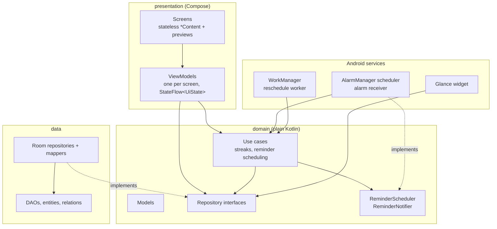

# Atomic

[](https://github.com/MichaelGift/Atomic/actions/workflows/ci.yml)

Break a goal into small tasks, finish a few each day, keep the streak going, and write down what you learn on the way.

Atomic is an offline-first Android app built with Kotlin, Jetpack Compose and Material 3. It is a portfolio project: the aim is a small product built the way a production app would be, with a layered architecture, tests, background work and CI.

| Today | Goal detail | Goals |
|:---:|:---:|:---:|
|  |  |  |
| **Journal** | **Dark theme** | **Home-screen widget** |
|  |  |  |

## Features

- **Today**: overdue and due-today tasks from every goal, with a one-tap complete and undo.
- **Streaks and stats**: current and best streak, plus a seven-day bar chart of completed tasks.
- **Goals**: a description, an optional deadline, and progress from their tasks. Goals can be edited, completed, reopened or deleted.
- **Reminders**: once, daily or weekly notifications per goal. They survive reboots and time-zone changes and keep their local time across daylight saving.
- **Journal**: searchable entries, optionally linked to a goal. Deleting a goal never deletes the writing.
- **Widget**: today's tasks, checkable from the home screen, and the current streak.
- Material You dynamic color, a dark theme, edge-to-edge layout and screen-reader descriptions for the chart.

## Architecture



Hilt wires the layers together. The domain layer has no Android or Room imports, so its rules are tested as plain JVM code.

```
app/src/main/java/com/myth/atomic/
├── domain/        models, repository interfaces, stats/ (streaks), reminders/ (recurrence and use cases)
├── data/          local/ (Room database, DAOs, entities, relations), repository/ (implementations, mappers)
├── presentation/  today/, goals/, goaldetail/, journal/, components/, navigation/, theme/
├── reminders/     AlarmManager scheduler, alarm receiver, notifier, reschedule worker
├── widget/        Glance widget, its data source and check-off action
└── di/            Hilt modules
```

### Design decisions

- **The domain owns the models.** Room entities stay in the data layer and are mapped at the repository boundary, so a schema change never reaches the UI.
- **Use cases only where there is logic.** Streak calculation, recurrence and alarm handling are use cases. Plain reads and writes go straight to a repository instead of through pass-through classes.
- **Completion is a timestamp, not a flag.** Storing `completedAt` is what makes streaks and the weekly chart possible.
- **Relational schema with explicit delete rules.** Tasks and reminders cascade with their goal. Journal entries are detached (`SET_NULL`) instead, so a user's writing is never lost as a side effect. Schemas are exported to `app/schemas/` for migration testing.
- **Reminders use AlarmManager and WorkManager together.** Each reminder is an alarm, exact when the user has granted exact alarms and inexact otherwise, so the app never nags for that permission. Android drops alarms on reboot, update and force-stop, so a worker re-registers them on each of those events and on app start.
- **Recurrence is computed in local time.** A daily reminder at 7:00 stays at 7:00 when daylight saving begins. A test covers the US spring-forward change.
- **Screens are split in two.** Each screen has a stateful `XScreen`, which takes its ViewModel from Hilt, and a stateless `XContent`. The stateless half is what the previews and Compose UI tests render.

## Testing

40 JVM tests run on every push, without an emulator:

| Area | How |
|---|---|
| Streak rules, recurrence, reminder use cases | Plain JUnit with in-memory fakes and a fixed `Clock` |
| ViewModels | Fakes, plus `kotlinx-coroutines-test` with a main-dispatcher rule |
| Room schema, relations, delete rules, queries | In-memory database under Robolectric |
| AlarmManager scheduling | Robolectric's `ShadowAlarmManager` |
| Compose UI | `createComposeRule` under Robolectric |

```bash
./gradlew testDebugUnitTest lintDebug
```

## Building

You need Android Studio (its bundled JDK 21 works) with the Android SDK. The build downloads Android 37 (compile) if it is missing.

```bash
./gradlew assembleDebug
```

The app runs on Android 8.0 (API 26) and later, and targets API 36.

## Tech stack

| | |
|---|---|
| Language | Kotlin 2.3, coroutines and Flow |
| UI | Jetpack Compose, Material 3, Navigation Compose with type-safe routes |
| Persistence | Room 2.8 (KSP) |
| Dependency injection | Hilt |
| Background work | AlarmManager, WorkManager |
| Widget | Jetpack Glance, with generated previews on Android 15+ |
| Testing | JUnit 4, Robolectric, kotlinx-coroutines-test, Compose UI test |
| Build | Gradle 9 with Kotlin DSL and a version catalog, AGP 9, GitHub Actions |

## Roadmap

- Reminders for individual tasks, and a "Mark done" action on the notification
- Export and import of goals and journal entries
- A two-pane layout for tablets and foldables
- Optional cloud sync
