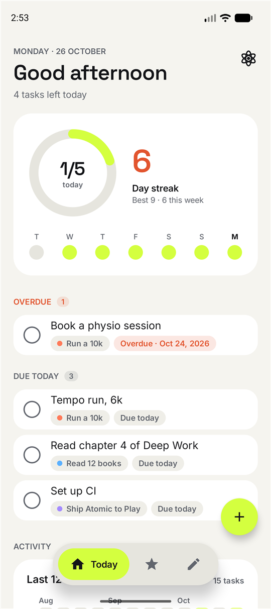
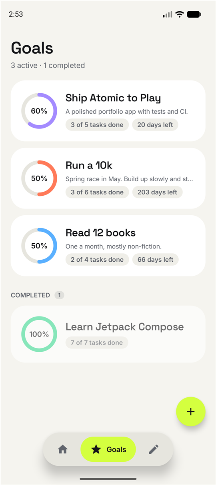
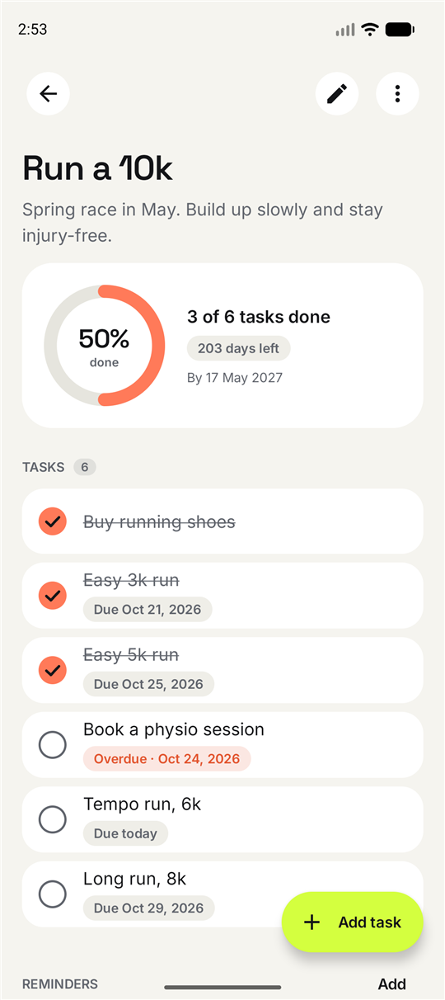
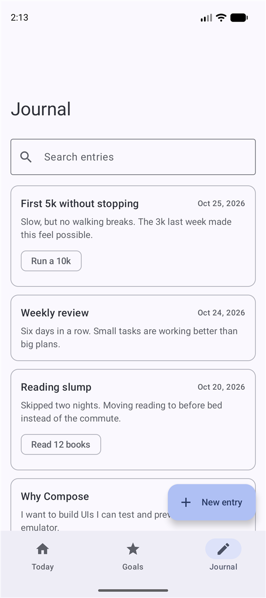
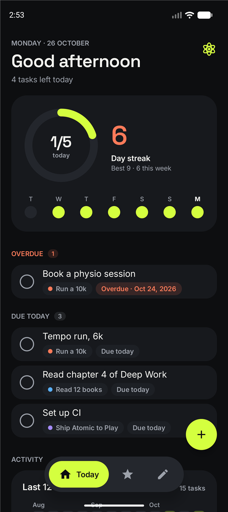
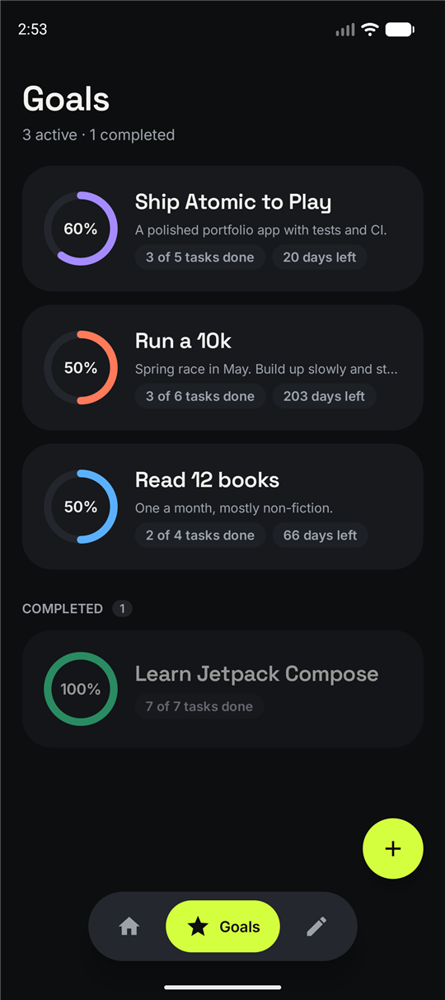
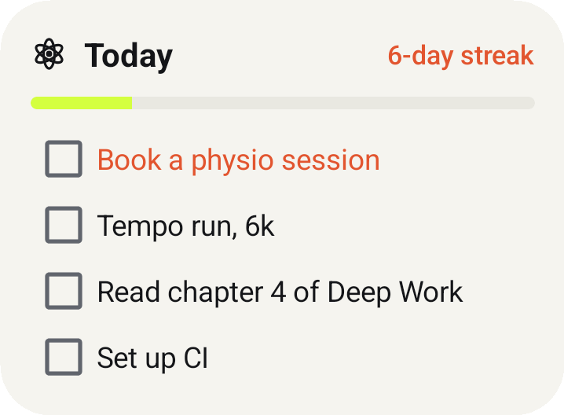
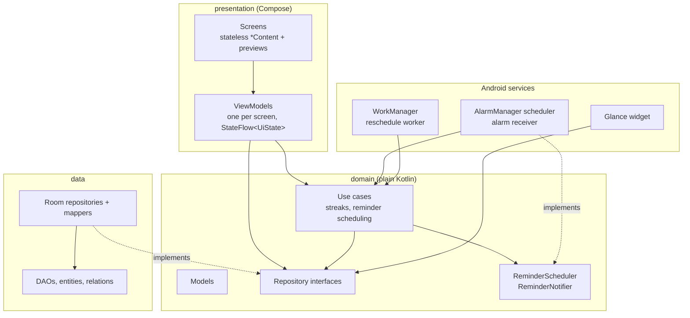

# Atomic

[](https://github.com/MichaelGift/Atomic/actions/workflows/ci.yml)

Break a goal into small tasks, finish a few each day, keep the streak going, and write down what you learn on the way.

Atomic is an offline-first Android app built with Kotlin, Jetpack Compose and Material 3. It is a portfolio project: the aim is a small product built the way a production app would be, with a layered architecture, tests, background work and CI.

| Today | Goals | Goal detail |
|:---:|:---:|:---:|
|  |  |  |
| **Journal** | **Today, dark** | **Goals, dark** |
|  |  |  |



## Features

- **Today**: a progress ring for the day, overdue and due-today tasks from every goal, and quick add straight into any goal. Completing a task has an animated check and an undo.
- **Streaks and activity**: current and best streak, a week strip, and a 12-week activity heatmap.
- **Goals**: each has its own color, a description, an optional deadline with a days-left countdown, and progress from its tasks. Goals can be edited, completed, reopened or deleted; tasks are swiped away to delete.
- **Reminders**: once, daily or weekly notifications per goal. They survive reboots and time-zone changes and keep their local time across daylight saving.
- **Journal**: searchable entries, optionally linked to a goal. Deleting a goal never deletes the writing.
- **Widget**: today's tasks, checkable from the home screen, and the current streak.
- Light and dark themes, an edge-to-edge layout, and screen-reader descriptions for the ring, heatmap and charts.

## Design

Atomic has its own visual identity instead of Material You's wallpaper colors, so it looks the same on every device.

- **Palette**: ink and paper neutrals with a single electric-lime accent for progress and primary actions, and an ember for streaks and anything overdue. Each goal picks one of six colors, which then tints its ring, checks, tags and reminders.
- **Type**: [Space Grotesk](https://fonts.google.com/specimen/Space+Grotesk) for headings and numbers, [Inter](https://fonts.google.com/specimen/Inter) for reading. Both ship as variable fonts under the SIL Open Font License (see `docs/licenses/`).
- **Shape and depth**: large-radius cards with no shadows; depth comes from tone. Only the floating navigation pill casts a shadow.
- **Motion**: rings spring to new values, checks fill, draw their tick and burst, and the nav pill widens to label the current tab.
- **Brand**: an atom mark for the adaptive launcher icon (with a monochrome layer for themed icons), the splash screen, notifications and the widget.

The tokens live in `presentation/theme/` (`Color.kt`, `Type.kt`, `Theme.kt`), and the shared pieces in `presentation/components/`: `ProgressRing`, `CheckButton`, `ActivityHeatmap`, `WeekStrip`, `FloatingNavBar`, `EditorSheet`, `TaskRow`, `Tag` and `AtomicCard`.

## Architecture



Hilt wires the layers together. The domain layer has no Android or Room imports, so its rules are tested as plain JVM code.

```
app/src/main/java/com/myth/atomic/
├── domain/        models, repository interfaces, stats/ (streaks), reminders/ (recurrence and use cases)
├── data/          local/ (Room database, DAOs, entities, relations), repository/ (implementations, mappers)
├── presentation/  today/, goals/, goaldetail/, journal/, components/, navigation/, theme/
├── reminders/     AlarmManager scheduler, alarm receiver, notifier, reschedule worker
├── widget/        Glance widget, its data source and check-off action
└── di/            Hilt modules
```

### Design decisions

- **The domain owns the models.** Room entities stay in the data layer and are mapped at the repository boundary, so a schema change never reaches the UI.
- **Use cases only where there is logic.** Streak calculation, recurrence and alarm handling are use cases. Plain reads and writes go straight to a repository instead of through pass-through classes.
- **Completion is a timestamp, not a flag.** Storing `completedAt` is what makes streaks and the weekly chart possible.
- **Relational schema with explicit delete rules.** Tasks and reminders cascade with their goal. Journal entries are detached (`SET_NULL`) instead, so a user's writing is never lost as a side effect.
- **Migrations are tested, not hoped for.** Schemas are exported to `app/schemas/`. Goal colors arrived in version 2 as a Room auto-migration, and a test upgrades a real version-1 database and checks the data survives.
- **Reminders use AlarmManager and WorkManager together.** Each reminder is an alarm, exact when the user has granted exact alarms and inexact otherwise, so the app never nags for that permission. Android drops alarms on reboot, update and force-stop, so a worker re-registers them on each of those events and on app start.
- **Recurrence is computed in local time.** A daily reminder at 7:00 stays at 7:00 when daylight saving begins. A test covers the US spring-forward change.
- **Screens are split in two.** Each screen has a stateful `XScreen`, which takes its ViewModel from Hilt, and a stateless `XContent`. The stateless half is what the previews and Compose UI tests render.

## Testing

42 JVM tests run on every push, without an emulator:

| Area | How |
|---|---|
| Streak rules, recurrence, reminder use cases | Plain JUnit with in-memory fakes and a fixed `Clock` |
| ViewModels | Fakes, plus `kotlinx-coroutines-test` with a main-dispatcher rule |
| Room schema, relations, delete rules, queries | In-memory database under Robolectric |
| Schema migrations | `MigrationTestHelper` upgrading databases built from the exported schemas |
| AlarmManager scheduling | Robolectric's `ShadowAlarmManager` |
| Compose UI | `createComposeRule` under Robolectric |

```bash
./gradlew testDebugUnitTest lintDebug
```

## Building

You need Android Studio (its bundled JDK 21 works) with the Android SDK. The build downloads Android 37 (compile) if it is missing.

```bash
./gradlew assembleDebug
```

The app runs on Android 8.0 (API 26) and later, and targets API 36.

## Releases

Pushing a version tag builds a signed APK and publishes it as a GitHub Release ([`release.yaml`](.github/workflows/release.yaml)):

```bash
git tag v1.0.0 && git push origin v1.0.0
```

The tag must point at a commit on `master`. The tag becomes `versionName` and the workflow run number (plus 100) becomes `versionCode`, so each release installs over the last. Tags with a suffix, such as `v1.1.0-beta.1`, are published as pre-releases. Before an APK is attached, the workflow runs the unit tests and checks the signature with `apksigner`.

Signing uses four repository secrets: `KEYSTORE_BASE64`, `KEYSTORE_PASSWORD`, `KEY_ALIAS` and `KEY_PASSWORD`. Locally, without them, `assembleRelease` produces an unsigned APK.

## Tech stack

| | |
|---|---|
| Language | Kotlin 2.3, coroutines and Flow |
| UI | Jetpack Compose, Material 3, Navigation Compose with type-safe routes |
| Persistence | Room 2.8 (KSP) |
| Dependency injection | Hilt |
| Background work | AlarmManager, WorkManager |
| Widget | Jetpack Glance, with generated previews on Android 15+ |
| Testing | JUnit 4, Robolectric, kotlinx-coroutines-test, Compose UI test |
| Build | Gradle 9 with Kotlin DSL and a version catalog, AGP 9, GitHub Actions |

## Roadmap

- Reminders for individual tasks, and a "Mark done" action on the notification
- Export and import of goals and journal entries
- A two-pane layout for tablets and foldables
- Optional cloud sync
